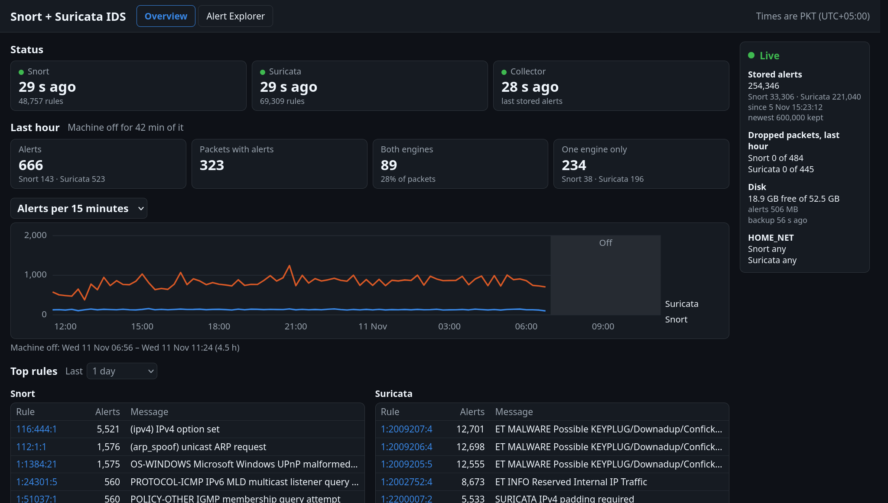
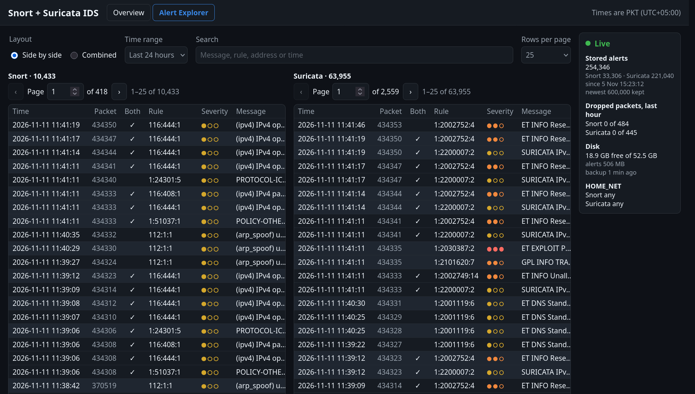

# Real-Time Network IDS Dashboard

A network intrusion detection sensor with a live web dashboard. Snort 3 and
Suricata 8 watch a network interface. A collector stores their alerts in
SQLite, and a small API serves a React dashboard and a combined JSON export
of both engines' alerts, for research and LLM datasets.

It runs on an Ubuntu VM in a lab today. It is set up so that it can move to
a Raspberry Pi and run one engine or both (see
[docs/modular-setup-plan.md](docs/modular-setup-plan.md)).





## Quick start

On an Ubuntu machine where Snort 3, Suricata 8 or both are installed and
running with their rules ([Setting up a machine](#setting-up-a-machine),
steps 1 and 2):

1. Download `IDS-Dashboard-<version>.zip` from the
   [latest release](https://github.com/Moeed0/IDS-Dashboard/releases/latest).
   Its dashboard page is already built, so Node.js isn't needed. Unzip it
   and go into its folder, `IDS-Dashboard`:

   ```bash
   unzip IDS-Dashboard-*.zip && cd IDS-Dashboard
   ```

2. Set everything up. It asks for your password for the steps that need
   sudo:

   ```bash
   ./setup.sh
   ```

3. Open `http://<the machine's address>:8501/`. The page asks for the API
   token, which `grep IDS_API_TOKEN .env` shows.

`setup.sh` makes the Python environment, copies `.env.example` to `.env` for
the engines it finds, builds the rule index, lets the collector read the
engines' logs, puts the 24 basic local rules into both engines
(`--no-local-rules` leaves them out), saves their rule counts, and installs
the collector and the dashboard as services that start at boot, with the
nightly backup and the hourly test alert. Check `.env`'s paths afterwards;
when one changes, run `./setup.sh` again (it keeps `.env`). It needs Python
3 with its `venv` module (tested with 3.13) and sudo. `./setup.sh --help`
lists its options.

From a `git clone` it works the same, but builds the page first, which
needs Node.js 22.

**Updating:** every release unzips into the same `IDS-Dashboard` folder. Put
the newer zip in the folder that holds it, then unzip over it and run the
setup again:

```bash
unzip -o IDS-Dashboard-v1.2.1.zip && cd IDS-Dashboard && ./setup.sh
```

That replaces the code and the page, and restarts the services with them.
`.env`, the stored alerts (`ids_live.db`), the alert archive and the
collector's places in the logs stay as they are, since no zip holds them.

## How it works

```
network interface (afpacket)
   ├── Snort 3     → /var/log/snort/alert_json.txt
   └── Suricata 8  → /var/log/suricata/eve.json
                          │
          src/live_dual_collector.py   reads both logs as they grow
                          │
                     ids_live.db       SQLite, the newest IDS_ALERT_RETENTION alerts;
                          │            older ones zipped in alert-archive/ for 30 days
          src/dashboard_api.py         API and the page, on port 8501
            ├── web/        the dashboard (Overview, Alert Explorer)
            └── /export     combined JSON, enriched from the rule index
                            and the offline threat-intel database
```

- **Overview:**
  - whether each engine and the collector run, how many packets each
    engine dropped in the last hour, and the last hourly test alert;
  - the last hour's alerts, and the packets one or both engines alerted on;
  - the last 24 hours, or a live chart of the last 15 minutes, with the
    times the machine was off shaded;
  - the top rules.
- **Alert Explorer:** every stored alert, grouped by packet (each alert has
  a 7-character UID from its minute and its number in that minute, and a
  packet is named by its first alert's), newest first, with filters for the
  time (the last 5 minutes to 30 days), engine, severity, protocol, class,
  service, app (as Snort's OpenAppID names it), rule, addresses and port, and "Show the newest" 5, 10, 20 or any
  number. A click on an alert shows all of it: its rule's text, why it
  fired, the other alerts on its packet, and "Raw output", each of those
  alerts' record as Snort or Suricata wrote it, and Snort's record of the
  TLS connection it was on. What the filters choose can be
  downloaded as combined JSON
  ([docs/combined-json-format.md](docs/combined-json-format.md)) or sent to
  the LLM PC (`IDS_LLM_URL` in `.env`), where `scripts/llm_receiver.py`
  saves each file in a folder (copy it there and run
  `python llm_receiver.py`; standard library only); the old alerts' zips
  are at the bottom. The file has no enrichment: the LLM PC fetches the
  threat-intel database from the dashboard (`/intel/intel.db`: NVD, EPSS,
  CISA KEV, MITRE ATT&CK, Talos's Snort rule documentation, Snort's own
  description of its built-in rules, FoxIO's and abuse.ch's known TLS
  fingerprints, domain-list-community's services of site names, and
  iptoasn.com's owners of IP addresses) and writes
  what it says of each file's rules, CVEs, ATT&CK techniques and TLS
  fingerprints as text for
  the LLM's prompt with `scripts/intel_lookup.py`
  (`python intel_lookup.py download http://<dashboard>:8501/`, then
  `python intel_lookup.py enrich <file>.json`; standard library only).

## What is where

| Path | What it holds |
|---|---|
| `setup.sh` | Sets the dashboard up on a machine in one go ([Quick start](#quick-start)) |
| `src/live_dual_collector.py` | The collector |
| `src/dashboard_api.py` | The API, which also serves the page |
| `src/ids/` | The shared code: settings, database, tailer, normalizer, screen data, combined export, rule and intel lookups, rule index builder |
| `web/` | The React page (TypeScript, Vite) |
| `deploy/` | systemd services, the engines' settings for this lab, log rotation ([deploy/README.md](deploy/README.md)) |
| `scripts/` | `download_intel_sources.py` downloads the threat-intel sources and builds the database from them with `import_offline_intelligence.py`; `save_rule_counts.py` saves the engines' rule counts; `backup_database.py` and `restore_backup.py` back the database up and put it back; `send_test_alert.py` is the hourly test alert; `download_talos_docs.py` saves every Snort rule's Talos page once, for the database; `llm_receiver.py` and `intel_lookup.py` run on the LLM PC (receive Sends; fetch the intel database and look up a file's CVEs and techniques) |
| `config/lab_phases.json` | The lab's attacker addresses, for the dashboard's warnings |
| `data/` | Data each machine builds or downloads ([data/README.md](data/README.md)) |
| `alert-archive/` | The alerts older than the database keeps, in 10-day zips (see [Old alerts](#old-alerts)) |
| `backups/` | The nightly copies of the alert database (see [Backups](#backups)) |
| `tests/` | The tests |
| `.github/workflows/` | On GitHub: the tests and the page's build on every push, and a release zip with the page built for each version tag |
| `docs/` | The API and data ([docs/react-native-port.md](docs/react-native-port.md)), the export format, the modular plan and the lab network: the router, the mirroring switch and adding switches and routers ([docs/lab-network.md](docs/lab-network.md)) |

## Setting up a machine

**A fresh Ubuntu VM, as this lab:** `deploy/new-vm.sh` does every step
below in one run: it installs Suricata and the packages, builds Snort 3
from source, fetches both engines' rules (it asks for your oinkcode), puts
this lab's engine settings in, and runs `./setup.sh --with-intel`. Clone the
repository as your user, find the card to watch with `ip -br link`, then:

```bash
sudo deploy/new-vm.sh --interface ens34
```

The steps by hand:

This repository holds the dashboard: the collector, the API and the page.
The engines and their rules come from their makers, so set those up first.
It is tested on Ubuntu with Python 3.13, and with Node.js 22 to build the
page. For a Raspberry Pi, see
[docs/modular-setup-plan.md](docs/modular-setup-plan.md).

### 1. The engines

Install Snort 3, Suricata, or both, on a machine that sees the traffic: on a
real network, through a switch's mirror port or a network tap. Each must
write its alerts as JSON:

- **Snort:** run it with `-A alert_json -l /var/log/snort`. This lab's
  service is `deploy/systemd/snort-lab.service` with its afpacket drop-in;
  change `ens38` to your interface.
- **Suricata:** its default settings already write alerts to
  `/var/log/suricata/eve.json`. Set your interface under `af-packet:` in
  `/etc/suricata/suricata.yaml`.

`deploy/README.md` lists this lab's settings for both.

### 2. The rules

Neither rule set is in this repository; each comes from its maker.

- **Suricata (ET Open, free):**

  ```bash
  sudo suricata-update
  ```

  This lab also turns on every rule and logs every match: it copies
  `deploy/suricata/enable.conf`, `disable.conf` and `modify.conf` to
  `/etc/suricata/` first. `modify.conf` also rewrites 7 ET rules that
  wouldn't load with HOME_NET `any`. This lab runs
  `sudo suricata-update --no-test`: with HOME_NET `any` suricata-update's
  own test can fail, and it then puts the old rules back.

- **Snort (registered rules, free with an account):** these rules are
  licensed to you and may not be shared, so each machine downloads its own.
  1. Make an account on snort.org, and copy your oinkcode from your account
     page.
  2. Download the rules for your Snort version (`31200` is Snort 3.12), and
     unpack them:

     ```bash
     read -rsp "Snort oinkcode: " OINKCODE; echo; curl -fL -o snortrules.tar.gz "https://www.snort.org/rules/snortrules-snapshot-31200.tar.gz?oinkcode=$OINKCODE"; unset OINKCODE
     ```

     ```bash
     sudo mkdir -p /usr/local/etc/snort/registered && sudo tar -xzf snortrules.tar.gz -C /usr/local/etc/snort/registered
     ```

  3. Point Snort at them: `RULE_PATH = '/usr/local/etc/snort/registered/rules'`
     in `snort.lua` (this lab's is `deploy/snort/snort.lua`). Then check
     that Snort accepts them:

     ```bash
     sudo snort -c /usr/local/etc/snort/snort.lua -T
     ```

  The package also holds Talos's shared-object (SO) rules, compiled for
  each system, and the free OpenAppID detectors name each flow's
  application for the app-detect rules. This lab loads both (53,485 rules
  in all): `deploy/update-rules.sh` copies the SO rules to
  `/usr/local/lib/snort/so_rules`, which Snort is started with
  (`--plugin-path`), and installs the detectors in
  `/usr/local/lib/openappid` (see [deploy/README.md](deploy/README.md)).

  Without an account, Snort's community rules (about 4,000) are free:
  `https://www.snort.org/downloads/community/snort3-community-rules.tar.gz`.

- **Local rules (in this repository):** `deploy/rules/local.rules` holds 24
  basic rules that both engines load from the same text, so a matching
  packet raises an alert from each: ping; the first packet of FTP, SSH,
  Telnet, SMB, RDP, MS-SQL, MySQL, PostgreSQL, VNC and Redis connections;
  TFTP and SNMP requests; and in a request, Nmap's scripts, sqlmap, Nikto,
  directory traversal, `/etc/passwd`, `/etc/shadow`, Shellshock,
  `UNION SELECT`, `<script>` and `cmd.exe`. Their SIDs start at
  1000001 and their messages with "LOCAL". `setup.sh` puts them into the
  engines; `--no-local-rules` leaves them out. To put them in, or take them
  out, later:

  ```bash
  deploy/install-local-rules.sh
  ```

  ```bash
  deploy/install-local-rules.sh --remove
  ```

  It installs them as `/etc/suricata/rules/local.rules` and
  `/usr/local/etc/snort/local.rules` (empty after `--remove`), adds those
  files to Suricata's `rule-files` and Snort's rules when they aren't
  there, checks both engines and reloads them, and updates the dashboard's
  rule counts and rule index. `IDS_LOCAL_RULES` in `.env` is empty on a
  machine without them. Edit the file and run it again to change them.

- **Keeping them up to date:** a timer fetches Suricata's rules every night
  and Snort's every week, checks them and loads them (`deploy/update-rules.sh`), the SO rules and OpenAppID
  detectors included.
  It asks once for the oinkcode, which only root can read afterwards:

  ```bash
  sudo deploy/install-rule-updates.sh
  ```

- **This lab's Suricata settings** (alert payloads as text, pcap files of the
  alerted flows, capture on `IDS_INTERFACE` with HOME_NET `any`, logs closed
  to other users, JA3/JA4 TLS fingerprints and their rules):

  ```bash
  sudo deploy/apply-suricata-settings.sh
  ```

### 3. Let the collector read the logs

The engines write their logs as root, and the collector runs as your user.
Once both logs exist, give your user read access (this uses the `acl`
package):

```bash
sudo setfacl -m u:$USER:r /var/log/snort/alert_json.txt /var/log/suricata/eve.json
```

```bash
sudo setfacl -d -m u:$USER:r /var/log/snort /var/log/suricata
```

The second command keeps new log files readable too.

### 4. The dashboard

`./setup.sh` does all of this and section 3 in one go (step 6 with
`--with-intel`; see [Quick start](#quick-start)). The steps are here to do
by hand.

1. Get the code and its Python packages. If your `python3` is not 3.13, use
   `python3.13`.

   ```bash
   git clone https://github.com/Moeed0/IDS-Dashboard.git && cd IDS-Dashboard
   ```

   ```bash
   python3 -m venv .venv && .venv/bin/pip install -r requirements.txt
   ```

2. Copy the settings. Then set this machine's values in `.env`: the engines
   it runs (`IDS_ENGINES`), their logs, and their rules and config files
   (`IDS_SNORT_RULES` is the `rules` folder from step 2).

   ```bash
   cp .env.example .env
   ```

3. Build the page:

   ```bash
   cd web && npm ci && npm run build && cd ..
   ```

4. Build the rule index, which the combined export uses for each rule's
   text:

   ```bash
   PYTHONPATH=src .venv/bin/python src/ids/build_rule_index.py
   ```

5. Save how many rules each engine loaded, which the Overview shows. Use
   your own Snort number, from the "total rules loaded" line of `snort -T`;
   Suricata's is read from its log.

   ```bash
   .venv/bin/python scripts/save_rule_counts.py --snort 53485 --suricata-log
   ```

6. Optional: build the threat-intel database, for the CVE, EPSS,
   known-exploited, ATT&CK and known TLS fingerprint details in the combined
   export. It downloads about 300 MB from NVD, FIRST, CISA, MITRE, FoxIO,
   abuse.ch, domain-list-community (GitHub) and iptoasn.com, and builds a database of
   up to 1.6 GB in a few minutes. Run it again whenever you want fresher data.
   Without it the export still works, without those details.

   ```bash
   .venv/bin/python scripts/download_intel_sources.py --build
   ```

7. Install the collector and the dashboard as services, which start at
   boot:

   ```bash
   sudo deploy/install-services.sh
   ```

8. Open `http://<machine>:8501/`. The page asks for the API token,
   `IDS_API_TOKEN` in `.env`, which the API creates on its first start.

## TLS fingerprints

Encrypted traffic can't be read, but before a connection is encrypted the
client says in plain text which TLS versions, ciphers and extensions it
supports. Suricata turns that into JA4 and JA3 fingerprints (and the server's
reply into JA3S): one per program (a browser, an app, a script, a piece of
malware), never what it sends. With `sudo deploy/apply-suricata-settings.sh`
(or `sudo deploy/install-tls-fingerprints.sh` alone):

- every Suricata alert on a TLS or QUIC connection carries its fingerprints,
  the site (SNI) and the ALPNs, so the combined JSON has them too;
- Suricata alerts on a client fingerprint new on the network (JA4), on a TLS
  client a device never used before, and on every connection with a
  fingerprint on the known-bad lists
  (`deploy/suricata/tls-fingerprints/known-bad-*.txt`; SIDs 1000101–1000108);
- the collector keeps each device's fingerprints (connections, first and
  last seen, sites), which the dashboard's **TLS Fingerprints** page shows.
  It names each one's program from the threat-intel database when FoxIO's
  JA4+ mapping or abuse.ch's malware JA3s list it, and puts its sites under
  the service each belongs to (www.youtube.com and i.ytimg.com under
  YouTube), from domain-list-community; each name is written once (a site
  two services list goes under the one already there), and a service named
  like the program only shows its sites. The Alert Explorer names the
  program and service of a Suricata alert's TLS or QUIC connection the
  same way, in a tag before its message ("Facebook", "Adguard") and in its
  alert panel. An alert with no TLS details of its own (a lone reset, a
  stream event, an IP rule) to or from an address a TLS handshake went to
  gets the service of the sites seen there, marked as probable
  ("Instagram?"): one address can serve several sites. The collector keeps
  each server address's sites for this (`tls_servers`). An address no
  handshake went to (a game's UDP servers, say) is named by the network
  that owns it, from iptoasn.com's list in the threat-intel database
  ("Tencent Building network?", "Zenlayer network?"): who runs the server,
  not necessarily the app. A name given with `scripts/tls_fingerprints.py
  --label` comes first; the combined JSON gives that name with it;
- Snort's extractor (`deploy/snort/snort.lua`) writes its own record of
  each TLS connection to `/var/log/snort/extractor_tls.json` (the
  site, the TLS version, cipher and curve, the certificate's subject and
  issuer), which the collector keeps (`snort_tls`, `src/ids/snort_tls.py`)
  to check alerts with: an alert on a connection both engines named the
  site of says "✓ both engines" in its panel, a site Snort recorded
  differently is written under it in red, and an alert with no TLS details
  of its own (any Snort alert, a lone reset) on a connection Snort
  recorded gets that connection's site for sure, without the "?". The
  panel gives each name once, with how the connection is encrypted and
  its certificate. Snort has no JA3 or JA4, and no QUIC inspector, so the
  programs and QUIC stay Suricata's;
- the threat-intel database holds FoxIO's JA4+ mapping, abuse.ch's malware
  JA3s and domain-list-community's sites of each service, which
  `intel_lookup.py` on the LLM PC looks the file's fingerprints up in
  (`download_intel_sources.py --fingerprints-only` adds them to an existing
  database).

The same from the command line, and adding a fingerprint to the known-bad
lists (run the installer with sudo after that):

```bash
PYTHONPATH=src .venv/bin/python scripts/tls_fingerprints.py
```

```bash
PYTHONPATH=src .venv/bin/python scripts/tls_fingerprints.py --bad <JA4 or JA3> "sqlmap"
```

A device is its IP address, so a device whose DHCP address changes starts
afresh. Snort makes no fingerprints.

## Old alerts

The database keeps the newest `IDS_ALERT_RETENTION` alerts: at about
46,000 alerts a day (mid-November), 600,000 is about 13 days and 1.3 GB. The older ones are not deleted: every minute the collector moves
them to `alert-archive/` (`IDS_ALERT_ARCHIVE_DIR`).

- `days/2026-11-13.jsonl.gz` holds a day's alerts (PKT), a line of JSON an
  alert with all its columns, while the day's 10-day period still has alerts
  in the database.
- Once a period has wholly left the database, its days are packed into
  `alerts_2026-11-03_to_2026-11-12.zip`, with a `.jsonl` file a day. The
  periods are fixed 10-day spans counted from 1 January 1970, so in November
  2026 they start on the 3rd, 13th and 23rd.
- The newest 3 zips stay, 30 days (`IDS_ALERT_ARCHIVE_DAYS=30` in
  `IDS_ALERT_ARCHIVE_ZIP_DAYS=10`-day zips): a new zip removes the oldest.
  A zip of 830,000 alerts was about 100 MB, so at 46,000 alerts a day one
  is about 55 MB.

With `IDS_ALERT_ARCHIVE_DAYS=0` the alerts past the limit are deleted
instead. When the archive can't be written (a full disk, say), the alerts
stay in the database, past its limit, until it can.

The Alert Explorer lists the zips and day files under "Old alerts", to
download from any computer. Its download holds the alerts in the database
that its filters choose; the API's export of a whole older window
(`GET /export`) takes its alerts from the archive. One export holds at most
`IDS_EXPORT_MAX_ALERTS` alerts (150,000), as building one takes about 8 KB
of memory an alert.

To look inside on the machine:

```bash
unzip -l alert-archive/alerts_2026-11-03_to_2026-11-12.zip
```

```bash
unzip -p alert-archive/alerts_2026-11-03_to_2026-11-12.zip 2026-11-05.jsonl | head -3
```

```bash
zcat alert-archive/days/2026-11-13.jsonl.gz | head -3
```

## Backups

Every night at 03:30 (or, when the machine was off then, 15 minutes after
the next start) the `ids-backup` timer checks the alert database (SQLite's quick_check, about
10 seconds for 500 MB) and makes a gzipped copy of it in `backups/`
(`IDS_BACKUP_DIR`), keeping the newest 3 (`IDS_BACKUP_KEEP`; 0 makes none). A
copy is about a tenth of the database's size. A damaged database isn't
copied, so it never pushes out the good backups. The status panel shows the
free disk space, how old the newest backup is and whether the database
passed its check. To make one now:

```bash
.venv/bin/python scripts/backup_database.py
```

The database is written with `synchronous=FULL`, so switching the machine
off mid-write shouldn't damage it. If it is damaged all the same (the
dashboard says "the database is damaged", the collector keeps restarting),
put the newest backup back. Stop the collector and the dashboard:

```bash
sudo systemctl stop ids-collector ids-dashboard
```

Restore (it checks the backup first, keeps the damaged database as
`ids_live-replaced-<time>.db`, and has the collector read the engines' logs
again from the start; name a backup to restore an older one):

```bash
.venv/bin/python scripts/restore_backup.py
```

Start them again: the collector stores the alerts made since the backup that
the logs still hold, and skips the ones the backup has:

```bash
sudo systemctl start ids-collector ids-dashboard
```

## The hourly test alert

At 5 past every hour the `ids-test-alert` timer sends one ping out of the
capture card to `IDS_TEST_ALERT_TARGET` (a machine on the capture network
that is always on, like the router; empty turns the test off). Each engine's
own rules flag a Linux ping (Snort 1:366 and 1:384, Suricata 1:2100366 and
1:2100384), so the test passes when both engines' alerts on it are stored
within 90 seconds: capture, the rules and the collector all work. The
Overview's strip shows the last test ("Snort ✓ · Suricata ✓"), and its
headline says "Test alert missed" when an engine's alert didn't come. Each
test adds about 9 alerts, from this machine to the target. To run one now:

```bash
.venv/bin/python scripts/send_test_alert.py
```

## Tests

```bash
.venv/bin/pip install -r requirements-dev.txt
PYTHONPATH=src .venv/bin/python -m pytest -q
```

The page's tests (the filters, the packet shading, the severity circles,
the status headline and the test alert), in `web/`, after `npm ci`:

```bash
npm test
```

## License

MIT; see [LICENSE](LICENSE).
