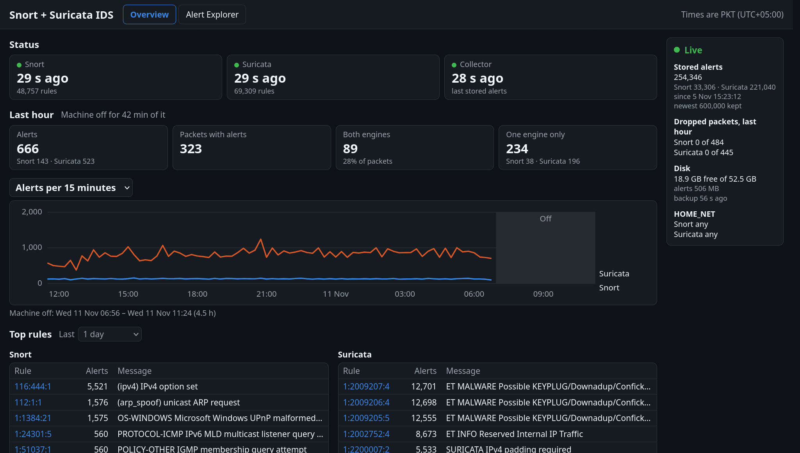
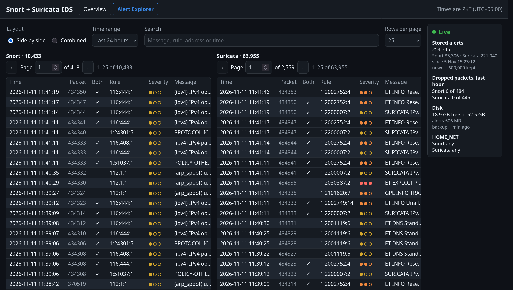

# Real-Time Network IDS Dashboard

A network intrusion detection sensor with a live web dashboard. Snort 3 and
Suricata 8 watch a network interface. A collector stores their alerts in
SQLite, and a small API serves a React dashboard and a combined JSON export
of both engines' alerts, for research and LLM datasets.

It runs on an Ubuntu VM in a lab today. It is set up so that it can move to
a Raspberry Pi and run one engine or both (see
[docs/modular-setup-plan.md](docs/modular-setup-plan.md)).





## Quick start

On an Ubuntu machine where Snort 3, Suricata 8 or both are installed and
running with their rules ([Setting up a machine](#setting-up-a-machine),
steps 1 and 2):

1. Download `IDS-Dashboard-<version>.zip` from the
   [latest release](https://github.com/Moeed0/IDS-Dashboard/releases/latest).
   Its dashboard page is already built, so Node.js isn't needed. Unzip it
   and go into its folder, `IDS-Dashboard`:

   ```bash
   unzip IDS-Dashboard-*.zip && cd IDS-Dashboard
   ```

2. Set everything up. It asks for your password for the steps that need
   sudo:

   ```bash
   ./setup.sh
   ```

3. Open `http://<the machine's address>:8501/`. The page asks for the API
   token, which `grep IDS_API_TOKEN .env` shows.

`setup.sh` makes the Python environment, copies `.env.example` to `.env` for
the engines it finds, builds the rule index, lets the collector read the
engines' logs, puts the 24 basic local rules into both engines
(`--no-local-rules` leaves them out), saves their rule counts, and installs
the collector and the dashboard as services that start at boot. Check `.env`'s paths afterwards;
when one changes, run `./setup.sh` again (it keeps `.env`). It needs Python
3 with its `venv` module (tested with 3.13) and sudo. `./setup.sh --help`
lists its options.

From a `git clone` it works the same, but builds the page first, which
needs Node.js 22.

**Updating:** every release unzips into the same `IDS-Dashboard` folder. Put
the newer zip in the folder that holds it, then unzip over it and run the
setup again:

```bash
unzip -o IDS-Dashboard-v1.0.1.zip && cd IDS-Dashboard && ./setup.sh
```

That replaces the code and the page, and restarts the services with them.
`.env`, the stored alerts (`ids_live.db`), the alert archive and the
collector's places in the logs stay as they are, since no zip holds them.

## How it works

```
network interface (afpacket)
   ├── Snort 3     → /var/log/snort/alert_json.txt
   └── Suricata 8  → /var/log/suricata/eve.json
                          │
          src/live_dual_collector.py   reads both logs as they grow
                          │
                     ids_live.db       SQLite, the newest IDS_ALERT_RETENTION alerts;
                          │            older ones zipped in alert-archive/ for 30 days
          src/dashboard_api.py         API and the page, on port 8501
            ├── web/        the dashboard (Overview, Alert Explorer)
            └── /export     combined JSON, enriched from the rule index
                            and the offline threat-intel database
```

- **Overview:**
  - whether each engine and the collector run, and how many packets each
    engine dropped in the last hour;
  - the last hour's alerts, and the packets one or both engines alerted on;
  - the last 24 hours, or a live chart of the last 15 minutes, with the
    times the machine was off shaded;
  - the top rules.
- **Alert Explorer:** every stored alert, searchable, the combined JSON
  for a chosen time window
  ([docs/combined-json-format.md](docs/combined-json-format.md)), and the
  old alerts' zips to download.

## What is where

| Path | What it holds |
|---|---|
| `setup.sh` | Sets the dashboard up on a machine in one go ([Quick start](#quick-start)) |
| `src/live_dual_collector.py` | The collector |
| `src/dashboard_api.py` | The API, which also serves the page |
| `src/ids/` | The shared code: settings, database, tailer, normalizer, screen data, combined export, rule and intel lookups, rule index builder |
| `web/` | The React page (TypeScript, Vite) |
| `deploy/` | systemd services, the engines' settings for this lab, log rotation ([deploy/README.md](deploy/README.md)) |
| `scripts/` | `download_intel_sources.py` downloads the threat-intel sources and builds the database from them with `import_offline_intelligence.py`; `save_rule_counts.py` saves the engines' rule counts |
| `config/lab_phases.json` | The lab's attacker addresses, for the dashboard's warnings |
| `data/` | Data each machine builds or downloads ([data/README.md](data/README.md)) |
| `alert-archive/` | The alerts older than the database keeps, in 10-day zips (see [Old alerts](#old-alerts)) |
| `backups/` | The nightly copies of the alert database (see [Backups](#backups)) |
| `tests/` | The tests |
| `.github/workflows/` | On GitHub: the tests and the page's build on every push, and a release zip with the page built for each version tag |
| `docs/` | The API and data ([docs/react-native-port.md](docs/react-native-port.md)), the export format and the modular plan |

## Setting up a machine

This repository holds the dashboard: the collector, the API and the page.
The engines and their rules come from their makers, so set those up first.
It is tested on Ubuntu with Python 3.13, and with Node.js 22 to build the
page. For a Raspberry Pi, see
[docs/modular-setup-plan.md](docs/modular-setup-plan.md).

### 1. The engines

Install Snort 3, Suricata, or both, on a machine that sees the traffic: on a
real network, through a switch's mirror port or a network tap. Each must
write its alerts as JSON:

- **Snort:** run it with `-A alert_json -l /var/log/snort`. This lab's
  service is `deploy/systemd/snort-lab.service` with its afpacket drop-in;
  change `ens38` to your interface.
- **Suricata:** its default settings already write alerts to
  `/var/log/suricata/eve.json`. Set your interface under `af-packet:` in
  `/etc/suricata/suricata.yaml`.

`deploy/README.md` lists this lab's settings for both.

### 2. The rules

Neither rule set is in this repository; each comes from its maker.

- **Suricata (ET Open, free):**

  ```bash
  sudo suricata-update
  ```

  This lab also turns on every rule and logs every match: it copies
  `deploy/suricata/enable.conf` and `modify.conf` to `/etc/suricata/` first.
  With HOME_NET `any`, run `sudo suricata-update --no-test` instead: its own
  test fails on 7 rules, and it then puts the old rules back.

- **Snort (registered rules, free with an account):** these rules are
  licensed to you and may not be shared, so each machine downloads its own.
  1. Make an account on snort.org, and copy your oinkcode from your account
     page.
  2. Download the rules for your Snort version (`31200` is Snort 3.12), and
     unpack them:

     ```bash
     read -rsp "Snort oinkcode: " OINKCODE; echo; curl -fL -o snortrules.tar.gz "https://www.snort.org/rules/snortrules-snapshot-31200.tar.gz?oinkcode=$OINKCODE"; unset OINKCODE
     ```

     ```bash
     sudo mkdir -p /usr/local/etc/snort/registered && sudo tar -xzf snortrules.tar.gz -C /usr/local/etc/snort/registered
     ```

  3. Point Snort at them: `RULE_PATH = '/usr/local/etc/snort/registered/rules'`
     in `snort.lua` (this lab's is `deploy/snort/snort.lua`). Then check
     that Snort accepts them:

     ```bash
     sudo snort -c /usr/local/etc/snort/snort.lua -T
     ```

  Without an account, Snort's community rules (about 4,000) are free:
  `https://www.snort.org/downloads/community/snort3-community-rules.tar.gz`.

- **Local rules (in this repository):** `deploy/rules/local.rules` holds 24
  basic rules that both engines load from the same text, so a matching
  packet raises an alert from each: ping; the first packet of FTP, SSH,
  Telnet, SMB, RDP, MS-SQL, MySQL, PostgreSQL, VNC and Redis connections;
  TFTP and SNMP requests; and in a request, Nmap's scripts, sqlmap, Nikto,
  directory traversal, `/etc/passwd`, `/etc/shadow`, Shellshock,
  `UNION SELECT`, `<script>` and `cmd.exe`. Their SIDs start at
  1000001 and their messages with "LOCAL". `setup.sh` puts them into the
  engines; `--no-local-rules` leaves them out. To put them in, or take them
  out, later:

  ```bash
  deploy/install-local-rules.sh
  ```

  ```bash
  deploy/install-local-rules.sh --remove
  ```

  It installs them as `/etc/suricata/rules/local.rules` and
  `/usr/local/etc/snort/local.rules` (empty after `--remove`), adds those
  files to Suricata's `rule-files` and Snort's rules when they aren't
  there, checks both engines and reloads them, and updates the dashboard's
  rule counts and rule index. `IDS_LOCAL_RULES` in `.env` is empty on a
  machine without them. Edit the file and run it again to change them.

### 3. Let the collector read the logs

The engines write their logs as root, and the collector runs as your user.
Once both logs exist, give your user read access (this uses the `acl`
package):

```bash
sudo setfacl -m u:$USER:r /var/log/snort/alert_json.txt /var/log/suricata/eve.json
```

```bash
sudo setfacl -d -m u:$USER:r /var/log/snort /var/log/suricata
```

The second command keeps new log files readable too.

### 4. The dashboard

`./setup.sh` does all of this and section 3 in one go (step 6 with
`--with-intel`; see [Quick start](#quick-start)). The steps are here to do
by hand.

1. Get the code and its Python packages. If your `python3` is not 3.13, use
   `python3.13`.

   ```bash
   git clone https://github.com/Moeed0/IDS-Dashboard.git && cd IDS-Dashboard
   ```

   ```bash
   python3 -m venv .venv && .venv/bin/pip install -r requirements.txt
   ```

2. Copy the settings. Then set this machine's values in `.env`: the engines
   it runs (`IDS_ENGINES`), their logs, and their rules and config files
   (`IDS_SNORT_RULES` is the `rules` folder from step 2).

   ```bash
   cp .env.example .env
   ```

3. Build the page:

   ```bash
   cd web && npm ci && npm run build && cd ..
   ```

4. Build the rule index, which the combined export uses for each rule's
   text:

   ```bash
   PYTHONPATH=src .venv/bin/python src/ids/build_rule_index.py
   ```

5. Save how many rules each engine loaded, which the Overview shows. Use
   your own Snort number, from the "total rules loaded" line of `snort -T`;
   Suricata's is read from its log.

   ```bash
   .venv/bin/python scripts/save_rule_counts.py --snort 48757 --suricata-log
   ```

6. Optional: build the threat-intel database, for the CVE, EPSS,
   known-exploited and ATT&CK details in the combined export. It downloads
   about 300 MB from NVD, FIRST, CISA and MITRE, and builds a 1.6 GB
   database in a few minutes. Run it again whenever you want fresher data.
   Without it the export still works, without those details.

   ```bash
   .venv/bin/python scripts/download_intel_sources.py --build
   ```

7. Install the collector and the dashboard as services, which start at
   boot:

   ```bash
   sudo deploy/install-services.sh
   ```

8. Open `http://<machine>:8501/`. The page asks for the API token,
   `IDS_API_TOKEN` in `.env`, which the API creates on its first start.

## Old alerts

The database keeps the newest `IDS_ALERT_RETENTION` alerts, about a week at
600,000. The older ones are not deleted: every minute the collector moves
them to `alert-archive/` (`IDS_ALERT_ARCHIVE_DIR`).

- `days/2026-11-13.jsonl.gz` holds a day's alerts (PKT), a line of JSON an
  alert with all its columns, while the day's 10-day period still has alerts
  in the database.
- Once a period has wholly left the database, its days are packed into
  `alerts_2026-11-03_to_2026-11-12.zip`, with a `.jsonl` file a day. The
  periods are fixed 10-day spans counted from 1 January 1970, so in November
  2026 they start on the 3rd, 13th and 23rd.
- The newest 3 zips stay, 30 days (`IDS_ALERT_ARCHIVE_DAYS=30` in
  `IDS_ALERT_ARCHIVE_ZIP_DAYS=10`-day zips): a new zip removes the oldest.
  At 83,000 alerts a day a zip is about 100 MB.

With `IDS_ALERT_ARCHIVE_DAYS=0` the alerts past the limit are deleted
instead. When the archive can't be written (a full disk, say), the alerts
stay in the database, past its limit, until it can.

The Alert Explorer lists the zips and day files under "Old alerts", to
download from any computer, and a combined export of an older window takes
its alerts from the archive. One export holds at most
`IDS_EXPORT_MAX_ALERTS` alerts (150,000), as building one takes about 8 KB
of memory an alert.

To look inside on the machine:

```bash
unzip -l alert-archive/alerts_2026-11-03_to_2026-11-12.zip
```

```bash
unzip -p alert-archive/alerts_2026-11-03_to_2026-11-12.zip 2026-11-05.jsonl | head -3
```

```bash
zcat alert-archive/days/2026-11-13.jsonl.gz | head -3
```

## Backups

Every night at 03:30 (or at the next start, when the machine was off then)
the `ids-backup` timer makes a gzipped copy of the alert database in
`backups/` (`IDS_BACKUP_DIR`) and keeps the newest 3 (`IDS_BACKUP_KEEP`; 0
makes none). A copy is about a tenth of the database's size. The status
panel shows the free disk space and how old the newest backup is. To make
one now, or to restore one (stop the collector and the dashboard first):

```bash
.venv/bin/python scripts/backup_database.py
```

```bash
gunzip -c backups/ids_live-20261110-033000.db.gz > ids_live.db
```

## Tests

```bash
.venv/bin/pip install -r requirements-dev.txt
PYTHONPATH=src .venv/bin/python -m pytest -q
```

## License

MIT; see [LICENSE](LICENSE).
